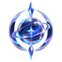

<div align="center">



# 透 Nova Anodite

**A glassmorphism new-tab experience for Chromium browsers**
Live WebGL backgrounds · Material clock · Weather · Sticker-style quick links · Editable graffiti title

[](#)
[](#-install)
[](https://github.com/xemonbae01)

[](https://github.com/xemonbae01/Nova-Anodite/stargazers)
[](https://github.com/xemonbae01/Nova-Anodite/network/members)
[](https://github.com/xemonbae01/Nova-Anodite/issues)
[](https://github.com/xemonbae01/Nova-Anodite/commits)
[](#-permissions--privacy)

[**⬇️ Install**](#-install) · [**📸 Screenshots**](#-screenshots) · [**✨ Features**](#-features) · [**🛠️ Troubleshooting**](#️-troubleshooting) · [**🐛 Report a bug**](https://github.com/xemonbae01/Nova-Anodite/issues)

</div>

---

## 📑 Table of contents

- [Screenshots](#-screenshots)
- [Features](#-features)
- [Install](#-install)
- [First-time setup](#️-first-time-setup)
- [Adding your own wallpapers](#️-adding-your-own-wallpapers)
- [Permissions & privacy](#-permissions--privacy)
- [Troubleshooting](#️-troubleshooting)
- [FAQ](#-faq)
- [Project structure](#-project-structure)
- [Contributing](#-contributing)
- [Credits & licenses](#-credits--licenses)

---

## 📸 Screenshots

<table>
  <tr>
    <th align="center">🖥️ Desktop</th>
    <th align="center">📱 Mobile</th>
  </tr>
  <tr>
    <td align="center">
      <a href="https://imgur.com/a/VTnr6PU">
        
      </a>
    </td>
    <td align="center">
      <a href="https://imgur.com/a/HUfOhO4">
        
      </a>
    </td>
  </tr>
</table>

<!--
  SHOW THE IMAGES INLINE (optional):
  Imgur album links (imgur.com/a/...) can't be embedded in a README — GitHub needs a DIRECT image link.
  1. Open your album → open the image → right-click → "Copy image address".
     It looks like: https://i.imgur.com/AbCdEfG.png   (note the "i." and the file extension)
  2. Delete the badge table above and un-comment the block below, pasting your direct links.

<table>
  <tr>
    <th align="center">🖥️ Desktop</th>
    <th align="center">📱 Mobile</th>
  </tr>
  <tr>
    <td align="center"><a href="https://imgur.com/a/VTnr6PU"></a></td>
    <td align="center"><a href="https://imgur.com/a/HUfOhO4"></a></td>
  </tr>
</table>
-->

---

## ✨ Features

| | |
|---|---|
| 🌌 **Live backgrounds** | *Liquid* (Opera GX-style, 5 palettes + custom colors), *Dark Veil*, *Balatro*, *Soft Aurora* — all GPU shaders |
| 🖼️ **Image wallpapers** | Drop images in a folder, or add them from the UI; random / cycle / fixed, plus a slideshow timer |
| 🕒 **Material clock** | Big glass clock, 12/24-hour, date with a marker underline |
| 🏷️ **Editable title** | A graffiti-tag title (default “Ash Redwan”) you can change or hide in settings |
| 🌦️ **Weather** | Free [Open-Meteo](https://open-meteo.com/) data, no API key; °C / °F; city search or your location |
| 🔗 **Quick links** | Glass tiles with favicons, shimmer-to-sharp loading, glow in each logo's color, letter fallback |
| 🎨 **Auto accent** | UI glows follow the dominant color of your wallpaper / live background |
| 🫥 **Hidden settings** | No button in the way: **double-tap** to open, double-tap again to hide |
| 🔍 **Smart search** | Uses your default search engine; type a URL and it opens directly |
| 📱 **Responsive** | Desktop, narrow windows and touch screens |
| 🔒 **Private by design** | No accounts, no analytics, everything stays on your device |

---

## 🚀 Install

> Nova Anodite is loaded as an *unpacked* extension (developer mode). It works on **Google Chrome, Microsoft Edge, Brave, Vivaldi** and other Chromium browsers.

### ⚡ Quick start

```bash
git clone https://github.com/xemonbae01/Nova-Anodite.git
```
Then: extensions page → **Developer mode** → **Load unpacked** → pick the `Nova-Anodite` folder → open a new tab.

### 1. Get the code

**Option A: Git**
```bash
git clone https://github.com/xemonbae01/Nova-Anodite.git
```

**Option B: ZIP**
[**Download ZIP**](https://github.com/xemonbae01/Nova-Anodite/archive/refs/heads/main.zip), or open the repository on GitHub → **Code → Download ZIP**, then unzip it anywhere you'll keep it.

> ⚠️ Don't delete or move the folder afterwards — the browser loads the extension straight from it.

### 2. Load it in your browser

1. Open the extensions page:

   | Browser | Address |
   |---|---|
   | Chrome | `chrome://extensions` |
   | Edge | `edge://extensions` |
   | Brave | `brave://extensions` |
   | Vivaldi | `vivaldi://extensions` |

2. Turn on **Developer mode** (top-right or left sidebar).
3. Click **Load unpacked**.
4. Select the **`Nova-Anodite`** folder (the one that contains `manifest.json`).
5. Open a **new tab**. 🎉

When Chrome asks about the new-tab page change, choose **Keep it**.

> **Opera / Opera GX:** Opera manages its own start page and can restrict extensions that replace the new tab, so it may not behave the same way as the Chromium browsers listed above.
>
> **Mobile:** Chrome for Android/iOS doesn't run extensions. The layout is responsive and works in narrow windows and in browsers that do support extensions (for example Kiwi Browser).

### 3. Update later

```bash
cd Nova-Anodite
git pull
```
Then open the extensions page and press the **reload ↻** button on the Nova Anodite card. Your settings and added images are kept.

> Downloaded the ZIP instead? Download the new ZIP, replace the old files in the same folder, then press **reload ↻**.

### 4. Uninstall
Extensions page → **Remove** on the Nova Anodite card.

---

## ⚙️ First-time setup

**Open settings:** *double-tap* (double-click) any empty spot on the page, or the bottom-right corner.
**Close settings:** double-tap empty space again, press **Esc**, or tap the glowing button in the corner.

| Section | What to do |
|---|---|
| **Title** | Type your own name or tagline (up to 24 characters). Empty = hidden. **Reset** restores “Ash Redwan”. |
| **Style** | Auto accent color from the wallpaper, or pick a custom accent. Toggle graffiti effects (drips, splatter, grain). |
| **Glass** | Transparency, blur and dim sliders. |
| **Live background** | Choose *Liquid*, *Dark Veil*, *Balatro* or *Soft Aurora*. Tune colors, Vibrance, Darkness, speed and **Quality** (Ultra = sharpest). Pick **Images** to go back to wallpapers. |
| **Images** | Mode (random / cycle / fixed), slideshow timer, thumbnails, **Add images**. |
| **Weather** | Type a city and press **Set**, or tap 📍 to use your location. Choose °C / °F. |
| **Quick links** | Add / remove sites. Or tap the dashed **+** tile on the page. |
| **Clock** | 12-hour or 24-hour format. |

### ⌨️ Shortcuts & gestures

| Action | How |
|---|---|
| Open / close settings | Double-tap empty space |
| Close settings | `Esc` |
| Focus search | `/` |
| Open a website directly | Type the URL in the search box |
| Add a quick link | Tap the dashed **+** tile |

---

## 🖼️ Adding your own wallpapers

**Easiest:** open settings → **Images → Add images**. No rebuild needed.

**Bundled with the extension:**
1. Put your images (`.jpg .png .webp .gif .avif`) into `assets/background/`.
2. Rebuild the image list (needs [Node.js](https://nodejs.org/)):
   ```bash
   node gen-list.js
   ```
3. Press **reload ↻** on the extension card.

> Browser extensions can't list a folder's contents at runtime, which is why `assets/background/list.json` is generated for you.

---

## 🔐 Permissions & privacy

| Permission | Why |
|---|---|
| `storage` | Save your settings on your device |
| `search` | Run searches with your default search engine |
| `favicon` | Show site logos on quick-link tiles |
| `geolocation` | Only used if you press 📍 for weather |
| `api.open-meteo.com`, `geocoding-api.open-meteo.com` | Weather and city lookup |

- Your settings, links and added images stay **on your device**. There's no analytics or tracking.
- Network requests: Open-Meteo (only when weather is set), and Google Fonts for the *Permanent Marker* and *Bungee* fonts. Offline, the UI falls back to system fonts.

---

## 🛠️ Troubleshooting

| Problem | Fix |
|---|---|
| Live background is black or missing | Enable **hardware acceleration** in your browser settings and restart it. |
| Live background is laggy | Settings → Live background → lower **Quality**, turn on **Battery saver**, or choose *Aurora* / *Liquid* (Dark Veil is the heaviest). |
| New wallpapers don't show up | Run `node gen-list.js`, then reload the extension. |
| Weather pill is missing | Set a city in settings → Weather. It needs an internet connection. |
| A quick-link logo shows a letter | The site has no icon the browser can read — that's the fallback. |
| Chrome says “Disable developer mode extensions” on startup | Normal for unpacked extensions. Dismiss it, or keep the extension enabled from the extensions page. |
| Extension disappeared after moving the folder | The browser loads from the original path. Move the folder back, or **Load unpacked** again from the new location. |
| Want to reset everything | Extensions page → Nova Anodite → **Details → Site settings / Clear data**, or remove and re-add the extension. |

Still stuck? [Open an issue](https://github.com/xemonbae01/Nova-Anodite/issues/new) and include your browser + version, OS, and what you see.

---

## ❓ FAQ

<details>
<summary><b>Is it on the Chrome Web Store?</b></summary>

Not at the moment. Install it as an unpacked extension (see [Install](#-install)).
</details>

<details>
<summary><b>Does it slow down my browser?</b></summary>

Live backgrounds use your GPU. If your device struggles, lower **Quality**, enable **Battery saver**, or switch to an image wallpaper.
</details>

<details>
<summary><b>Does it collect any data?</b></summary>

No. There's no analytics or tracking. Settings, links and images are stored locally on your device.
</details>

<details>
<summary><b>Can I use it on my phone?</b></summary>

Chrome on Android/iOS doesn't support extensions, but Chromium-based browsers that do (like Kiwi Browser) can run it, and the layout is responsive.
</details>

<details>
<summary><b>How do I change “Ash Redwan” to my own name?</b></summary>

Double-tap empty space to open settings → **Title** → type your own text (up to 24 characters).
</details>

---

## 📁 Project structure

```
Nova-Anodite/
├── manifest.json        # Manifest V3 config (new-tab override, permissions, icons)
├── newtab.html          # The new-tab page
├── newtab.css           # Glassmorphism + graffiti styling
├── newtab.js            # Clock, weather, links, settings, backgrounds, title
├── live.js              # WebGL shaders: Liquid, Dark Veil, Balatro, Soft Aurora
├── gen-list.js          # Builds assets/background/list.json
├── icons/               # Extension logo (16 / 32 / 48 / 128 / 256)
└── assets/background/   # Wallpapers + list.json
```

---

## 🤝 Contributing

Contributions, ideas and bug reports are welcome!

1. [Fork](https://github.com/xemonbae01/Nova-Anodite/fork) the repo
2. Create a branch: `git checkout -b feature/my-idea`
3. Commit your changes: `git commit -m "Add my idea"`
4. Push: `git push origin feature/my-idea`
5. Open a [Pull Request](https://github.com/xemonbae01/Nova-Anodite/pulls)

Found a bug or have a feature request? [Open an issue](https://github.com/xemonbae01/Nova-Anodite/issues).

If you like the project, a ⭐ on [GitHub](https://github.com/xemonbae01/Nova-Anodite) means a lot!

---

## 🙏 Credits & licenses

- **Developer:** [Redwan Ahemed](https://github.com/xemonbae01) (xemonbae01)
- Weather data by [Open-Meteo](https://open-meteo.com/) (free for non-commercial use, attribution requested).
- Fonts: *Permanent Marker* and *Bungee* via Google Fonts (SIL Open Font License).
- The *Dark Veil*, *Balatro* and *Soft Aurora* shader effects are adapted from open-source `ogl`-based React components and rewritten as plain WebGL. Check the original projects' licenses before redistributing.
- Wallpapers and the logo belong to their respective creators.

<div align="center">

Made with 💜 by **Redwan Ahemed** · [github.com/xemonbae01/Nova-Anodite](https://github.com/xemonbae01/Nova-Anodite)

</div>
